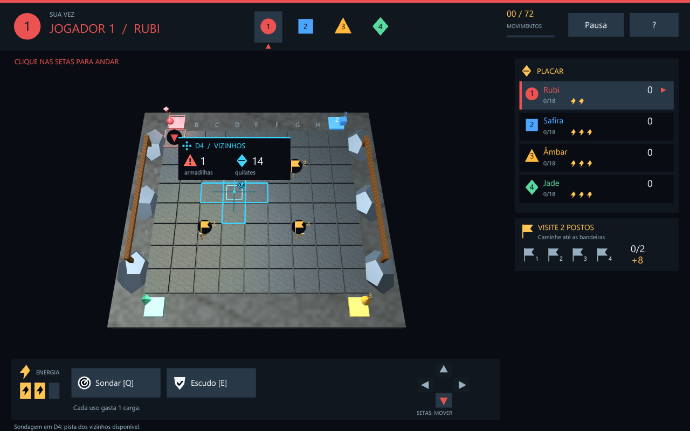

# Mina de Cristal

**Explore uma mina em 3D, interprete pistas e escolha onde gastar seus recursos para terminar com mais quilates.**

Mina de Cristal é um jogo local de exploração por turnos para **2 a 4 jogadores**, desenvolvido em **Python e PyOpenGL**. Cada partida acontece em um tabuleiro de **8 × 9 casas**, com tesouros ocultos, armadilhas e **72 movimentos** divididos igualmente entre os participantes.

As pistas ajudam a comparar caminhos antes de avançar. O radar permite consultar regiões ainda ocultas, o escudo protege contra uma perda de pontos e os postos de exploração recompensam quem planeja uma rota.



## Destaques

- **Exploração com pistas:** quantidade de armadilhas e soma dos quilates dos vizinhos, apresentadas diretamente sobre o tabuleiro.
- **Recursos limitados:** três cargas por jogador para dividir entre radar e escudo.
- **Objetivos de percurso:** visitar dois postos diferentes rende um bônus de oito quilates.
- **Turnos visuais:** cor, número e forma identificam cada jogador; a iluminação acompanha o participante da vez.
- **Cena 3D:** câmera com rotação e zoom, texturas procedurais, iluminação e modelos distintos para jogadores e itens.
- **Interface adaptável:** menus por mouse ou teclado, leitura flutuante das pistas e fontes com antialiasing.

O projeto foi desenvolvido como **trabalho da disciplina de Computação Gráfica**, a partir do enunciado [Procurando o Tesouro](documentos/Trabalho_Pratico_2_CG.pdf).

## Executar

No PowerShell, na pasta do projeto:

```powershell
python -m pip install -r requirements.txt
python main.py
```

Use Python 3.10 ou superior e uma sessão gráfica com OpenGL de compatibilidade, GLU e FreeGLUT. O pacote PyOpenGL fornece os vínculos Python; as bibliotecas nativas também precisam estar instaladas. Não são necessários NumPy, imagens externas nem internet durante o jogo. As texturas de pedra e madeira são geradas na inicialização.

O jogo solicita MSAA 4×, tenta 2× quando necessário e continua sem MSAA se o contexto não oferecer suporte. A quantidade efetiva aparece no terminal. A interface se adapta ao tamanho da janela.

As letras da interface e dos rótulos no tabuleiro usam fontes TrueType com antialiasing próprio, inclusive quando o MSAA não está disponível. O Pillow rasteriza os textos em resolução ampliada e eles são desenhados como texturas com transparência e filtragem linear. Os textos mantêm acentos e acompanham o redimensionamento da janela.

## Começar e reconhecer seu turno

Escolha 2, 3 ou 4 jogadores e inicie a partida. O jogo começa imediatamente, e os turnos passam automaticamente após cada movimento válido.

O jogador ativo aparece em uma faixa destacada, com **número, cor e forma**, no placar e junto do avatar no tabuleiro. Uma luz acompanha o jogador visível da vez. O avatar oculto por esconderijo permanece invisível.

| Jogador | Avatar | Entrada | Primeiro movimento |
| --- | --- | --- | --- |
| 1 — Rubi | Esfera vermelha | A1 | Baixo |
| 2 — Safira | Cubo azul | I1 | Baixo |
| 3 — Âmbar | Cone amarelo | I8 | Cima |
| 4 — Jade | Octaedro verde | A8 | Cima |

As entradas ficam fora da mina. As colunas são A–I e as linhas são 1–8. As setas seguem os eixos do tabuleiro mesmo quando a câmera gira. As casas destacadas indicam destinos válidos e também podem ser escolhidas com o mouse.

## Decidir para onde ir

Cada casa explorada fornece uma pista sobre seus **quatro vizinhos ortogonais**: quantidade de armadilhas e soma dos quilates dos diamantes. A interface usa ícones e números para apresentar essas informações. Escolha ou passe o mouse sobre uma casa para consultar suas pistas.

As contagens incluem vizinhos já revelados: são informações fixas da região, que podem ser cruzadas com as pistas de outras casas. A pista não revela o modelo nem o conteúdo exato de uma casa oculta. Casas desconhecidas sem sondagem não fornecem pistas.

### Equipamentos

Cada jogador começa com **3 cargas**, compartilhadas entre dois equipamentos. Usá-los não consome um movimento:

- **Sondar [Q]:** entre no modo de sondagem e escolha uma casa oculta. Gasta uma carga para obter as pistas da vizinhança dessa casa, sem explorá-la ou pontuar. A sondagem fica disponível somente para o jogador que a realizou. Sondar novamente a mesma casa, ou uma casa já explorada, não gasta cargas.
- **Escudo [E]:** gasta uma carga e protege contra a próxima perda própria de pontos: a saída de um túnel ou o efeito de um esconderijo de adversário. Uma proteção ativa não pode ser acumulada. O escudo não cancela a invisibilidade do descobridor do esconderijo nem dá imunidade permanente.

As cargas e a proteção ativa aparecem visualmente na interface. A seleção do modo de sondagem pode ser cancelada antes de escolher a casa; só a sondagem concluída custa uma carga.

As pistas aparecem em uma **leitura flutuante junto à casa sob o mouse**, com ícones e números para a **quantidade de armadilhas** e a **soma dos quilates dos quatro vizinhos em cruz**. A própria casa consultada não entra nessas contagens. Os vizinhos consultados ficam destacados, e a leitura identifica sua coordenada de origem. Fora do tabuleiro, ela acompanha a casa do peão que tem a vez. Casas desconhecidas sem sondagem mostram interrogações; casas sondadas conservam um ícone de radar e podem ser consultadas novamente pelo seu autor. Não há painel lateral de pistas.

### Postos de exploração

Quatro bandeiras públicas ficam em **C3, G3, C6 e G6**, independentemente dos itens ocultos. Cada jogador recebe **+8 quilates ao visitar dois postos distintos**, uma única vez por partida. O progresso aparece com os símbolos das bandeiras. Todos podem cumprir o objetivo; passar novamente pelo mesmo posto não aumenta o progresso.

## Controles

| Controle | Ação |
| --- | --- |
| Enter no menu | Iniciar a partida |
| Setas / clique em destino destacado | Mover uma casa adjacente |
| Q / botão Sondar | Selecionar ou cancelar a sondagem |
| E / botão Escudo | Ativar uma proteção |
| Mouse sobre o tabuleiro | Consultar pistas disponíveis |
| W / S e A / D | Inclinar e girar a câmera |
| Z / X ou roda do mouse | Aproximar e afastar |
| Arraste com botão esquerdo | Girar a câmera |
| Espaço | Restaurar a câmera |
| P / Esc durante a partida | Pausar / continuar |
| H | Abrir ajuda; H ou Esc retorna |
| R | Reiniciar com a mesma quantidade de jogadores |
| M | Voltar ao menu |
| Esc no resultado | Voltar ao menu |
| Esc no menu | Sair |

Segurar uma tecla não repete jogadas. Pausa e ajuda não permitem movimento nem gasto de equipamentos.

## Regras e pontuação

- Cada movimento válido, incluindo a entrada, consome um turno. A partida termina após **72 movimentos**: 36, 24 ou 18 por participante, para 2, 3 ou 4 jogadores. Movimentos inválidos preservam o turno e os efeitos pendentes. Depois de entrar, não é possível sair da mina.
- São **61 diamantes** de 1 a 10 quilates, **4 pistas Prossiga**, **4 túneis** e **3 esconderijos**, embaralhados. Quatro pistas e sete armadilhas aproximam os percentuais de 5% e 10% em 72 casas.
- Um conteúdo só aparece e produz seu efeito na primeira exploração. Casas podem ser revisitadas e compartilhadas, sem repetir o prêmio ou a armadilha. O marcador permanente identifica o primeiro descobridor.
- **Diamante:** soma seu valor. **Prossiga:** +3 quilates. **Túnel:** -10 quando o descobridor sair em um movimento válido. **Esconderijo:** cada adversário perde 5 e o descobridor fica invisível até seu próximo movimento válido. O escudo bloqueia a próxima perda do seu portador.
- O bônus dos postos é independente do conteúdo da casa e pode ser obtido ao visitar uma casa já explorada.
- Pontos negativos são permitidos. Vence a maior pontuação; empates compartilham a vitória.
- Reiniciar limpa mapa, posições, pontuação, cargas, escudos, sondagens, postos, efeitos e contador de turnos.

## Diferenciais em relação ao enunciado

| Diferencial | Implementação |
| --- | --- |
| Pistas extras | Contagens dos quatro vizinhos e sondagens sem revelar itens |
| Itens extras | Reserva limitada de energia para sondagem e escudo |
| Objetivos extras | Percurso por dois postos diferentes para ganhar bônus |
| Efeitos de iluminação | Luz do jogador da vez, além da iluminação base da mina |

O tabuleiro maior continua sendo múltiplo de 12. Os ícones e os destaques na faixa, no avatar e no placar reforçam a identificação do participante e das ações disponíveis.

## Organização e verificação

`jogo.py` contém as regras, sem depender de OpenGL. `main.py` desenha a cena, a interface e trata os controles. `texto_suave.py` renderiza as fontes com antialiasing e mantém seu cache de texturas. O enunciado da atividade está em `documentos/`.

Testes das regras, sem janela:

```powershell
python -m unittest discover -s tests -v
```

Verificação com contexto OpenGL real:

```powershell
python tests/verificar_grafico.py
python tests/verificar_grafico.py --capturas "$env:TEMP/tesouro-validacao"
```

O verificador gráfico exercita ocultação, sondagem, equipamentos, objetivo, alternância automática sem confirmação, câmera, menus, redimensionamento, reinício e partidas de 72 movimentos para 2, 3 e 4 jogadores. A opção de capturas gera PNGs para inspeção visual; as imagens não são recursos usados pelo jogo.
